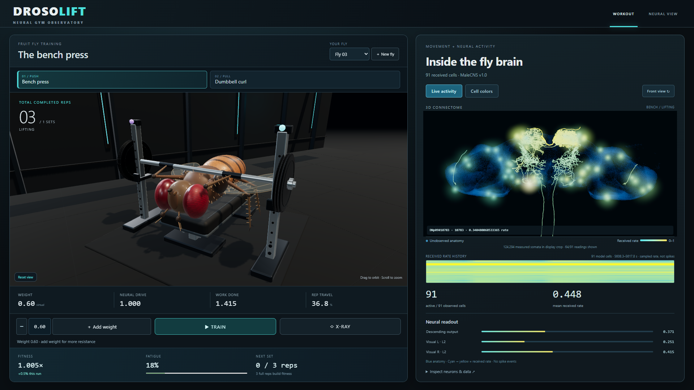

# DrosoLift Observatory

[](https://github.com/lupumihnea/drosolift/actions/workflows/ci.yml)

DrosoLift adds an English conference interface to the audited FlyBrain Lab gym at
commit `2c5a03aa90f01048f011e13546b4d7fffc693945`, with its license and notices.
Python owns the actual compact neural circuit, joint, repetitions and clock.
The new Apache-2.0 procedural fly has six articulated legs; its forelegs follow
the received bar pose. The large atlas uses official MaleCNS soma positions and
eight publicly licensed selected skeletons. Rate activity is shown without invented
spike events. The body pose and gym force mapping are authored model assumptions.



Run it locally; no hosted service or account is required. For a saved gym with
independent browser profiles, follow [SELF_HOST.md](docs/drosolift/SELF_HOST.md).
The repository includes an offline recorded sample, source/data provenance, CI
and optional container/static-host configuration. Nothing deploys automatically.
The implementation's full upstream history remains preserved locally; the public
source snapshot omits a legacy asset without redistribution rights and its old
renders. [RELEASE.md](docs/drosolift/RELEASE.md) explains the source lineage.

### Start on Windows

From the implementation checkout, install once:

```powershell
python -m venv .venv
.venv\Scripts\python.exe -m pip install -r requirements.lock.txt
npm install --prefix .tools bun@1.4.4
.tools\node_modules\bun\bin\bun.exe install --cwd frontend/web --frozen-lockfile
.venv\Scripts\python.exe scripts/download_malecns.py
.tools\node_modules\bun\bin\bun.exe --bun run --cwd frontend/web build
```

The official source download is 1.109 GB, SHA256 verified and Git-ignored. A clean
source checkout needs it for live edge validation; the portable replay needs no
raw data. Python 3.12 and Bun 1.4.4 were used for this implementation. `--bun`
ensures the pinned build tools do not run through an older host Node installation.

One live run command:

```powershell
.venv\Scripts\python.exe -B main.py gym-web --flies 1 --seed 7 --feedback apparatus-visual-v1
```

Open [the workout](http://127.0.0.1:8000/). **Add weight** and **Remove weight**
change the selected equipment by 0.2 virtual units within 0.1–3.0. Applied weights
are visible as plate stacks; a queued weight finishes the current rep first.
Choose an individual in **Your fly**, or use **New fly** to activate another
independently tracked trainee. **Train / Pause training** controls the real model
clock. Three full repetitions complete a set and earn +0.005 fitness (cap 1.5).
The main screen shows received fitness, fatigue and set progress; fitness and
workout totals last for the current `gym-web` server run. The opt-in
[`public-web` entry point](docs/drosolift/SELF_HOST.md#local-saved-gym) saves full
progress and learning in private browser profiles across backend restarts.
Bench press and Dumbbell curl queue a safe apparatus change after the current
stroke. Completed repetitions remain cumulative. The optional feedback profile
models apparatus indicator lights through the existing bilateral L2 inputs:
bench emphasizes the left indicator and curls the right. These are engineered
visual cues, not biological exercise-specialized brain regions. The ordinary
gym default remains `--feedback none`; earlier comparisons retain that default.
**Inspect neurons & data → Data & model details** preserves the 1–10 population
setup, provenance and exact exports. Cameras, X-ray and neuron selection are
observer controls. Click an exact reading or highlighted soma to
keep its official body ID selected as activity ranks change. Received zeros and
unobserved anatomy are distinct. The frontal blue brain view shows received
rates in cyan/yellow, with a rate-history strip and a separate Cell colors mode.
Eight official SWC morphologies stay in their native atlas frame. Full CNS and
Circuit views remain in the data disclosure. Circuit offers an authored layout of
the actual compact circuit; group meters show means of received values. X-ray
adds received neural markers and motor-command routing inside an explicitly
illustrative body scaffold. No within-body atlas registration is claimed.
[Current UI and training evidence](docs/drosolift/TRAINING_UI.md) and
[the previous demo upgrade](docs/drosolift/DEMO_UPGRADE.md) describe the display
mapping and experimental limits.

### Portable conference replay

Build, package and serve a recorded demo without the model server:

```powershell
.tools\node_modules\bun\bin\bun.exe --bun run --cwd frontend/web build:replay
.venv\Scripts\python.exe scripts/package_conference.py --output data/runs/drosolift-conference-v3.zip
.venv\Scripts\python.exe scripts/serve_replay.py
```

Open [the offline sample](http://127.0.0.1:8010/). The replay build opens in
RECORDED mode by default and offers separate bench and curl samples, each with
201 actual states over 20 model seconds and 91 official circuit IDs. Bench
completes five repetitions and curl six. It supports seek,
restart, speed and exact inspection. Exports and local-video alignment are under
the data/model disclosure. Video time equals playhead minus recording start plus
the entered offset; the video stays local. The ZIP at
`data/runs/drosolift-conference-v3.zip` includes the built app,
sample, source/asset notices and startup instructions. Serve its extracted folder
over HTTP with its bundled `python serve.py`, including under a subpath; opening
`index.html` by `file://` is unsupported. The server sets JavaScript MIME types
explicitly, avoiding a Windows registry mapping found during verification.

Regenerate the source recording or comparison:

```powershell
.venv\Scripts\python.exe -m experiments.record_gym --output data/runs/bench --seconds 20 --dt .1 --load .6 --seed 7 --no-learning
.venv\Scripts\python.exe -m experiments.record_gym --output data/runs/demo-curl --seconds 20 --dt .1 --load .4 --seed 7 --no-learning --exercise bicep_curl --feedback apparatus-visual-v1
.venv\Scripts\python.exe -m experiments.bench_comparison --calibration-recording frontend/web/public/samples/bench.json
```

The fixed-budget comparison is an explicitly open-loop recorded neural waveform
versus a periodic controller, using identical mechanics and commanded impulse.
It includes ties and greater periodic work; it does not establish biological or
general neural superiority. [Methods, results and plots](docs/drosolift/COMPARISON.md)
are inspectable. Optional plotting uses `requirements-analysis.txt`.

### Verification and provenance

The [milestone evidence](docs/drosolift/IMPLEMENTATION_PLAN.md),
[baseline](docs/drosolift/BASELINE.md), [asset rights](docs/drosolift/ASSETS.md),
[morphology sources](docs/drosolift/MORPHOLOGY.md) and
[control protocol](docs/drosolift/PROTOCOL.md) document exact commands and gaps.
The fly is a stylized original rig; the reference images remain the target for
later anatomical surface/detail work. The atlas contains 139,659 measured somata,
whereas the compact circuit transmits 91 rate readings.

```powershell
.venv\Scripts\python.exe -B -m unittest discover -s tests -t . -v
.venv\Scripts\python.exe -B main.py data-status
.tools\node_modules\bun\bin\bun.exe test --cwd frontend/web
.tools\node_modules\bun\bin\bun.exe --bun run --cwd frontend/web build
# Browser evidence (verification-only dependency):
.venv\Scripts\python.exe -m pip install playwright
.venv\Scripts\python.exe -m playwright install ffmpeg
# Current audience-flow acceptance (servers on 8000/8010):
.venv\Scripts\python.exe -m scripts.check_training_ui
# Earlier demo-v2 checks/screenshots remain in the milestone evidence.
```

GNU Make users can use `make drosolift`, `make download-data`, `make replay-build`,
`make record`, `make comparison`, `make training-check` and `make conference-v3`, with the appropriate
`PYTHON` override. The original entry-point documentation follows below.

---

# FlyBrain Lab (upstream documentation)

[](LICENSE)

FlyBrain Lab is a from-scratch, inspectable neural-control simulation using the
official MaleCNS v1.0 connectome. Experiment 1 contains one fly, a dynamic food
source, hunger, bilateral smell, simple vision, persistent appetitive odor
memory, and selectable compact or full-connectome neural engines. Experiment 2
adds usable bench presses and dumbbell curls, 1-10 independent flies, fatigue, completed-set
rewards, separate food/gym odor memory, and a live anatomical neuron display.

It is not a consciousness simulation. Neural activity shown in the terminal is
numerical model telemetry, not a claim that the simulated fly has subjective
experience.

## Preview

The [historical upstream preview](https://github.com/tiredbooy/Fruit-Fly/tree/2c5a03aa90f01048f011e13546b4d7fffc693945/docs/media)
uses the earlier visual asset. Those media are omitted from the public DrosoLift
snapshot. See the modern screenshot above and
[the actual DrosoLift recording](docs/drosolift/evidence/demo-v3/drosolift-training-demo.webm).

## Requirements

- Python 3.14 virtual environment at `.venv/`
- Python packages from `requirements.txt`: NumPy, pandas, PyArrow, SciPy, and aiohttp
- Bun 1.4 or newer for the browser build
- GNU Make for the short commands below
- Official MaleCNS files in `data/raw/malecns/v1.0/`

## Run

Run the gym with three flies:

```bash
make gym FLIES=3
```

Open <http://127.0.0.1:8000>. Enter 1-10 in the population field, apply it,
and select a fly to inspect its workout, memory, neurons, or eye camera.
Forelegs follow the moving bar/dumbbells. Three full up/down repetitions earn
a set reward. Experiment 2's explicit continuous-training apparatus keeps every
active fly at its assigned bench or curl station during a two-second recovery,
then exposes it to the next set. Repetitions still require brain-generated motor
drive and loaded joint motion. Removing a fly releases its equipment and
preserves its memory. Pause freezes physics; count changes still apply at a
clock boundary. No frontend command steers the flies.

For a finite headless gym run: `make gym-run FLIES=3`.
Gym uses the validated compact circuit, not the full brain.
See [equipment equations and measured runs](docs/science/equipment.md) for the
current model and learning-enabled/disabled comparison; the original
[resistance-lane model](docs/science/gym.md) remains documented historically.
Initial station exposure is configured, not learned. Sustained workout-seeking
has not been demonstrated; sustained attendance is externally imposed by the
experiment protocol. Reward is a model signal, not evidence
of pleasure, consciousness, or addiction. No flight physics is implemented.

After updating, stop an old server with `Ctrl+C` before running `make gym` again.
The new gym uses telemetry schema 3; the rebuilt browser also accepts the old
schema-2 gym and unchanged schema-1 Experiment 1. Memory files are unchanged.

Experiment 1 remains available unchanged:

```bash
make data-status
make run
```

Open the live Three.js observatory:

```bash
make web
```

Then visit <http://127.0.0.1:8000>. The browser shows the fly, food, odor
response, anatomical neuron activity, hunger, official descending-neuron labels,
motor output, reward, and learned association. Its only command is pause/resume;
Python remains the sole simulation authority.

The fly uses the authored, rigged visual asset you supplied in `fly-escape`.
Only appearance is reused; brain and behavior code remain independent.
Drag to orbit the 3D arena, scroll to zoom, or choose overview, fly-follow, or
fly-eye view. Eye view follows the body's heading; it is an approximate observer
camera, not a reconstruction of compound-eye vision.
The neuron panel maps actual activity onto 139,659 measured MaleCNS soma
positions. Unobserved locations differ from received zero readings; neurons
without soma positions are not assigned invented ones. Expand exact readings
for official IDs, labels, and numerical activity.
Search by ID or label to inspect a neuron; its count describes the received
subset, not all active neurons in the full brain.
The graphics label reports WebGPU when available and WebGL2 otherwise.
WebGPU rendering does not move the Python brain computation onto the GPU.
See [observatory maintenance](docs/frontend-observatory.md) for controls, source
attribution, asset rebuilding, and browser tests.

Build and run all 166,606 valid MaleCNS v1.0 neurons:

```bash
make brain-build
make brain-status
make run-full
```

The generated 198.3 MiB artifact stays under `data/processed/` and is not
committed. `make brain-build` recreates it from checksum-pinned official files.

Stop the animation with `Ctrl+C`. The terminal interface uses English text and
ASCII framing, with a fly emoji for the body. A terminal that cannot encode the
emoji automatically receives an `F` fallback.

Food starts absent, appears after a random delay, and changes position over
time. Most spawns are at least five world units from the fly; 20 percent appear
outside the accessible arena and expire later. Use a seed to replay the same
spawn sequence:

```bash
.venv/bin/python -B main.py run --animate --seed 1234
```

## Commands

```text
make run          Run Experiment 1 with persistent learned memory
make run-fresh    Archive existing memory and start with clean memory
make run-full     Run Experiment 1 with the full MaleCNS backend
make web          Build and run the Three.js observatory with compact brain
make web-full     Build and run the observatory with the full brain
make gym FLIES=3  Build and run the compact multi-fly gym
make gym-run FLIES=3  Run a finite headless gym
make gym-build    Reproduce official DM2 gym circuits
make frontend-build  Test types and build browser assets
make frontend-test   Test browser telemetry, camera fitting, and model integrity
make test         Run the complete test suite
make data-status  Verify official data, annotations, roles, and edge weights
make brain-build  Build the full memory-mapped sparse graph
make brain-status Validate the full graph and source identity
make brain-benchmark  Measure full-graph neural update speed
make help         Print available commands
```

The equivalent direct command is:

```bash
.venv/bin/python -B main.py run --animate
```

Compact remains the default. Full mode never silently falls back:

```bash
.venv/bin/python -B main.py run --animate --brain full
```

## Memory

The default learned state is stored in:

```text
data/runs/experiment-001-memory.json
```

The file records versioned multipliers for official KC-to-MBON01 structural
edges. It is local runtime state and is not committed. `make run-fresh` archives
the previous file before starting with clean memory.

Gym memories are separate: `data/runs/experiment-002/fly-N/{food,gym}-memory.json`.
Each channel is versioned and atomically saved. Corrupt/incompatible files fail
clearly. Body position, fatigue and workout totals reset on process restart;
learned memory does not. Use `--memory-dir` with separate directories for trials.

## Architecture

```text
world -> sensors -> brain adapter -> MaleCNS network -> motor -> fly body
                       ^                                  |
                       |                                  v
                learning and memory <- ingestion reward -+
```

The world exposes physics and contact only. It cannot choose walking or turning.
Hunger and learned association continuously modulate neural input instead of
triggering behavior rules.

Detailed documentation:

- `docs/architecture.md`: package boundaries and runtime sequencing
- `docs/science/equipment.md`: current bench/curl physics, assumptions and measured trials
- `docs/science/gym.md`: original resistance-lane provenance and learning model
- `docs/neural-performance-2026-09-13.md`: compact update equivalence and timing evidence
- `docs/science/learning-memory.md`: evidence, equations, IDs, and assumptions
- `docs/science/full-connectome.md`: full-graph filtering, polarity, and dynamics
- `docs/status.md`: current verified state and limitations
- `docs/decisions/`: architectural decision history
- `AGENTS.md`: permanent contributor and coding-agent rules

## Tests

```bash
make test
```

No neuron identifier, class, transmitter, or connection may be invented. Run
`make data-status` after changing a circuit manifest.

## License and attribution

FlyBrain Lab's original source code, documentation, and project-produced media
are Copyright 2026 tiredbooy and licensed under the
[Apache License 2.0](LICENSE). Redistributed derivative works must preserve the
license, changed-file notices, relevant attribution notices, and the project
[`NOTICE`](NOTICE) as required by Apache-2.0. Third-party datasets and visual
assets retain their separate terms; see
[`THIRD_PARTY_NOTICES.md`](THIRD_PARTY_NOTICES.md).
