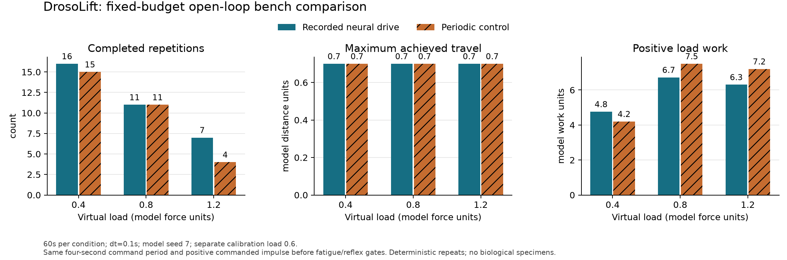

# Fixed-budget bench comparison

This is a deterministic comparison of two **open-loop command waveforms** in the
engineered DrosoLift bench. It is not an animal experiment or evidence that the
compact circuit learns a superior exercise policy.

## Frozen calibration and task

The separate nominal-load recording is `frontend/web/public/samples/bench.json`:
model seed 7, fresh memories, learning disabled, 0.1 s neural samples, load 0.6 model
force units. It uses official MaleCNS v1.0 IDs and pinned compact circuit hashes.
The evaluation loads, declared in code before evaluation, are 0.4, 0.8 and 1.2.
Each condition starts from the identical body, exercise and physiology state,
with a 60 s duration, 0.1 s command samples and the unchanged 0.01 s equipment physics.
Each condition has a distinct run identity and retains its exact initial state.

Take the 40 received motor-forward commands at 8 < t ≤ 12 s in the calibration run.
Their range is 0.48271737480101257..0.48574410946247804. Repeat that window with a
fixed 4 s period for 15 cycles. The period is an authored experimental input window,
not an estimate of a biological neural oscillation. The resulting condition is
labeled `recorded-neural`. Its numerical commands derive from actual compact
neural activity, but the evaluation intentionally has no online neural feedback.

The periodic comparator is a bounded rectangular input on the same 40-sample
period. Its positive duty is at least 50%, increased if needed to keep amplitude
at most 1. Here 20 samples are on at amplitude 0.9685932919998985, followed by 20
zero samples. It is a meaningful ordinary periodic controller, fixed before the
load sweep. Neither condition is retuned on evaluation loads.

The matched budget is **commanded positive actuator impulse before fatigue,
lowering and recovery gates**:

```text
J_commanded = 6 * sum(clamp(motor_forward,0,1)) * dt
```

Both have 11.623119503998783 model force-seconds per cycle, and
174.34679255998174 over 60 s. This does not match applied impulse: the existing
apparatus suppresses force on the downward return and during recovery, and
scales by capacity. Timing relative to these gates is allowed to affect outcomes.
The unchanged mapping is documented in [equipment.md](../science/equipment.md):
`forward=clamp(3*0.5*(forward_left+forward_right),0,1)`, actuator gain 6,
capacity `(1-0.75*fatigue)*fitness`, damping 3, gravity 1, travel 0.7.

## Outcomes

| Load | Recorded neural reps | Periodic reps | Recorded neural work | Periodic work |
| ---: | ---: | ---: | ---: | ---: |
|0.4|16|15|4.760000|4.200000|
|0.8|11|11|6.720000|7.499729|
|1.2|7|4|6.305143|7.201256|

Every condition reached the full 0.7 model-distance top stop. Repetitions count
only full up/down strokes. Positive work includes actual positive travel from
partial strokes, so a condition with fewer completed repetitions may still
perform more work. The periodic controller ties repetition count at load 0.8
and produces more positive work at loads 0.8 and 1.2. These results do not establish
an overall neural advantage.

All six conditions were rerun and every mechanics sample and summary matched
exactly. These repeats are reproducibility checks; they are not independent
specimens, uncertainty intervals or inferential statistics. Model seed 7 identifies
the source simulation setup, not a biological specimen. No biological calibration
of these force, travel or work units is claimed.



## Reproduce and inspect

From repository root on Windows:

```powershell
.venv\Scripts\python.exe -m experiments.bench_comparison --calibration-recording frontend/web/public/samples/bench.json --output data/runs/comparison
.venv\Scripts\python.exe -m pip install -r requirements-analysis.txt
.venv\Scripts\python.exe -m experiments.plot_bench_comparison --input data/runs/comparison --output docs/drosolift/evidence/p4-comparison
.venv\Scripts\python.exe -m unittest tests.test_bench_comparison -v
```

The first command needs no backend and uses the bundled verified calibration
recording. Omitting `--calibration-recording` regenerates the 20 s source recording
through the normal source-validated compact composition, requiring ignored raw
MaleCNS files. The plotting dependency is optional and does not affect the app.
The plot reads saved `summary.csv`; it does not rerun or alter either condition.

`data/runs/comparison/` is Git-ignored and contains calibration with actual neural
samples, one exact JSON and matching CSV per condition, summary CSV, source
metadata/circuit checksums, initial states, run IDs and deterministic-repeat flags.
The calibration SHA256 is
`474b9703981290773589086811778861ece092a5ccb08ca764cf1af167f6d97d`.
Small summary evidence and PNG/SVG figures are retained under `evidence/`.

Five focused regressions passed in 0.011 s: exact cycle-budget equality,
whole-trajectory deterministic repeats, zero drive, heavier-load displacement,
and top-stop travel between saved samples. The last regression first exposed
undersampling of maximum travel; evaluation now observes every existing physics
substep while exporting at the declared command grid. The PNG was visually
inspected for labels, legend, scale and clipping; SVG is exported from the same
Matplotlib figure.

Broader online controllers, alternative duty/period baselines, sensitivity to
calibration windows, model seeds, sensory feedback, physiological calibration and
biological validation remain separate work. These outputs support a conference
presentation about this computational model and its engineered apparatus only.
